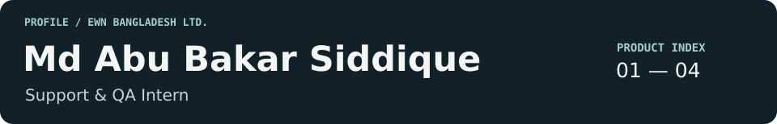
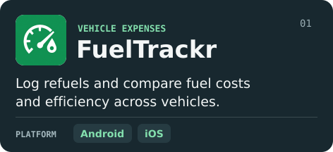
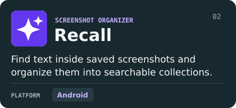
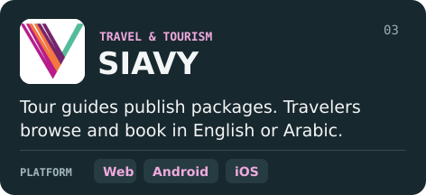
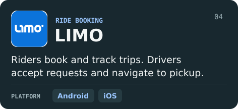

[Portfolio](https://siddique.page.gd) · [LinkedIn](https://linkedin.com/in/siddique0203) · [Email](mailto:siddique0203@gmail.com) · [Public repositories](https://github.com/siddique0203?tab=repositories)

## Products at EWN Bangladesh Ltd.

<table>
<tr>
<td width="50%"></td>
<td width="50%"></td>
</tr>
<tr>
<td></td>
<td></td>
</tr>
</table>

<strong>Inside the work: SIAVY &amp; LIMO</strong>

**SIAVY** · I follow both sides of a booking: a Tour Guide manages a package, and a customer saves it to Favorites, signs up and checks out. Across web, Android and iOS, I test account and dashboard actions, payment calculations, bilingual screens and currency display. I run smoke, functional, end-to-end and regression checks, then document defects and retest fixes. For release reviews, I update client notes and help prepare release notes and App Store feature graphics.

**LIMO** · Each week I review UXCam recordings to see how people interact with the app. When a session suggests a problem, I trace the actions leading up to it and use the recording as evidence for the QA investigation.

## At my desk

**API testing** · Postman　 **Analytics** · Firebase DebugView, GA4　 **Sessions** · UXCam  
**Releases** · TestFlight, Play Console　 **Defects** · Jira　 **Learning** · Playwright

## Selected personal & academic work

| Project | What I worked on |
| :--- | :--- |
| **SymptoGuard** | Compared symptom-based classifiers and used SHAP to explain their predictions. |
| **Crafty** | Designed manual tests for user workflows and documented reproducible defects. |

[Explore more of my work →](https://github.com/siddique0203?tab=repositories)

**B.Sc. in Computer Science & Engineering** · American International University-Bangladesh · 2022–2026
